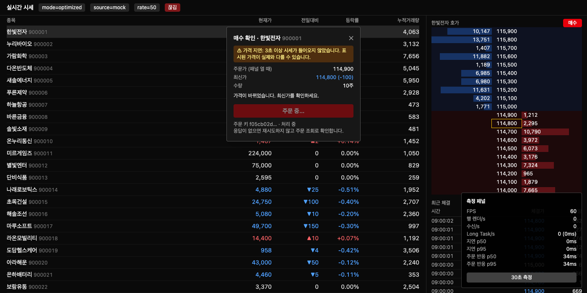
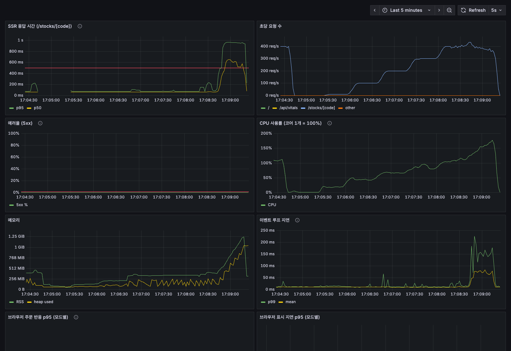
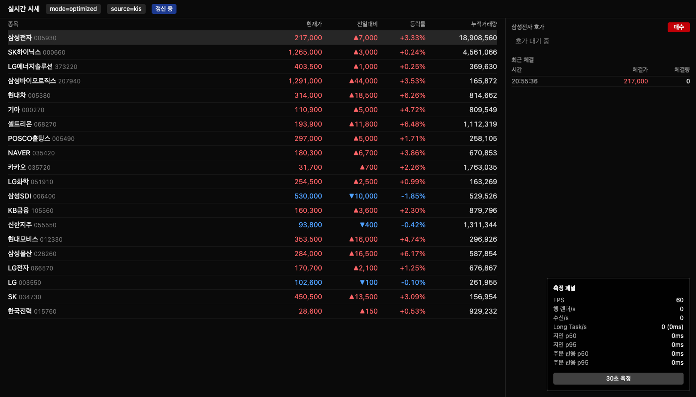

# 실시간 시세 MTS — 장 초반 부하를 재현하고 수치로 개선하기

장 시작 직후처럼 **시세와 고객이 한꺼번에 몰리는 순간**에도 화면은 끊기지 않고, FE 서버는 페이지를 그려내며, 실제 시세 연결은 안정적으로 유지되는지를 세 관점에서 **재현 → 감지 → 개선 → 재측정**했습니다.

| 관점 | 질문 | 부하 | 핵심 결과 |
|---|---|---|---|
| A. 브라우저 | 시세가 쏟아져도 화면과 주문 버튼이 버티는가 | Mock 시세 서버 (rate, burst) | 저사양(CPU 20x)·rate 500에서 주문 반응 p95 **11.7초 → 0.65초** |
| B. FE 서버 (SSR) | 고객이 몰려도 페이지를 그리는가, Pod 몇 개가 필요한가 | k6 + API 모킹 | CPU 1개 컨테이너 한계 ≈ 150 req/s |
| C. 실제 연결 | 안 볼 때는 자원을 아끼고, 돌아오면 바로 최신으로 맞추는가 | 한국투자증권 KIS 실시간 시세 | 60초 숨김 후 복귀 → 약 0.3초 만에 최신화 |

> 수치는 아래 각 절의 조건에서 측정했습니다. 원본 값 전체는 `docs/results.md`에 있습니다.

---

## 실행

```bash
pnpm install
pnpm build && pnpm start          # Next 서버 (커스텀 서버, 포트 3000) — 성능 측정은 반드시 프로덕션 빌드
pnpm mock                         # Mock 시세 서버 ws://localhost:8787
pnpm relay                        # KIS 중계 서버 ws://localhost:8788 (.env.local에 KIS_APP_KEY, KIS_APP_SECRET)
pnpm test && pnpm typecheck       # 단위 테스트 124개

# B. SSR 부하
API_MOCK=1 pnpm build && API_MOCK=1 pnpm start
docker compose -f docker-compose.monitoring.yml up -d   # Grafana http://localhost:3001
k6 run -e RAMP=10,100,200,300,400,500 load/ssr-load.js
```

| 주소 | 설명 |
|---|---|
| `/?mode=naive\|batched\|optimized&rate=200` | 시세 화면. `rate`는 초당 메시지 수, `burst=1`은 접속 후 10초간 5배 |
| `/?source=kis&mode=optimized` | KIS 실데이터 (장중 09:00~15:30) |
| `/?…&autoclick=1` | 측정 중 0.5초마다 매수 패널 자동 열기 (주문 반응 비교용) |
| `/stocks/005930` | SSR 종목 상세 |

## 구조

```
[Mock 시세 서버] ─┐
                  ├─ WebSocket (내부 프레임 {t, raw, s?}) ─→ [브라우저: 시세 화면] ── 에러 → Sentry
[KIS 중계 서버] ──┘                                              └─ 지표 → /api/vitals
      └─ KIS WebSocket + REST (키는 서버에서만)
[k6] ─→ [Next 커스텀 서버: SSR /stocks/[code]] ── /api/metrics ─→ Prometheus → Grafana
```

- 브라우저는 소스(Mock·KIS)와 상관없이 **같은 내부 프레임**(KIS 원문 형식)만 받습니다. 그래서 Mock으로 측정한 결과가 실데이터 경로와 같은 코드를 지납니다.
- 시세 파싱·배칭·지표 계산·재연결 상태 전이는 모두 `src/lib`의 순수 함수이고 단위 테스트가 있습니다.

---

## A. 브라우저 부하 — 시세가 쏟아질 때

### 문제
메시지마다 화면을 다시 그리면 장 초반에 프레임이 떨어지고, **주문 버튼을 눌러도 반응이 늦어집니다**. 시세 화면이 느린 것보다, 주문이 늦게 열리는 것이 고객에게 더 치명적입니다.

### 측정 방법
- Mock 시세 서버: 초당 메시지 수(`rate`)를 조절하고, 인기 종목 상위 5개가 메시지의 60%, burst 구간에는 다건 메시지 (실제 장 초반 패턴). `seed`로 같은 순서 재현
- 측정 패널(30초): FPS(최저 포함), 행 렌더 수, Long Task, 표시 지연 p50/p95, **주문 반응 시간 p50/p95**
- **주문 반응 시간** = 클릭 시각 → 주문 패널이 그려진 직후 (rAF → setTimeout으로 다음 paint 근사)
  - Event Timing API(INP)는 실제 사용자 입력만 기록해서 자동 클릭 비교에 쓸 수 없어 직접 정의했습니다. 자동 클릭은 "원래 실행됐어야 하는 시각"을 시작점으로 써서, 메인 스레드가 바빠 클릭이 늦게 처리된 대기 시간까지 포함합니다
- 조건: 프로덕션 빌드, Chrome 시크릿 창, DevTools CPU 쓰로틀링 **20x(저사양 극한)·6x(중간 사양)**, 각 30초 2회
  - 4x에서는 이 Mac(M 시리즈)에서 naive도 rate 2,000까지 60fps라 차이가 재현되지 않았습니다. 배수를 올려가며 naive가 무너지기 시작하는 조건을 찾았습니다

### 개선 단계
| 모드 | 방식 | 노린 것 |
|---|---|---|
| `naive` | 메시지마다 setState, 페이지 state 하나 | 비교 기준 (수정 금지) |
| `batched` | 메시지를 버퍼에 모아 `requestAnimationFrame`마다 한 번 반영 | 렌더 **횟수** ≤ FPS |
| `optimized` | 외부 스토어 + `useSyncExternalStore` 종목별 구독 + `React.memo` + 체결 링 버퍼 + `table-layout: fixed` + `contain` | 바뀐 행만, 브라우저 Layout·Paint 범위까지 줄이기 |

### 결과 (실제 Chrome 창, 30초 × 2회, `/`로 구분)

**중간 사양 (CPU 6x, rate 200)** — 평균 FPS는 모두 60, 차이는 꼬리에서

| 모드 | 평균 FPS | 최저 FPS | 행 렌더/s | 표시 지연 p95 | 주문 반응 p95 |
|---|---|---|---|---|---|
| naive | 59.3 / 57.9 | 54 / 38 | 4,177 / 3,619 | 41 / 51ms | 51 / 62ms |
| batched | 58.7 / 59.6 | 49 / 44 | 1,857 / 1,897 | 52 / 42ms | 64 / 55ms |
| optimized | 59.9 / 60 | **59 / 59** | **157 / 158** | **20 / 20ms** | **20 / 24ms** |

**저사양 극한 (CPU 20x)** — 모두 버벅이지만 주문 반응이 갈린다

| 모드 | rate | 평균 FPS | 표시 지연 p95 | 주문 반응 p95 |
|---|---|---|---|---|
| naive | 200 | 6.3 / 6.3 | 570 / 494ms | 4,611 / 1,222ms |
| batched | 200 | 7.3 / 7.4 | 618 / 588ms | 1,055 / 885ms |
| optimized | 200 | **12.9 / 9.4** | **289 / 365ms** | **375 / 542ms** |
| naive | 500 | 7.1 / 7.4 | 751 / 686ms | 12,135 / 11,311ms |
| batched | 500 | 6.6 / 6.5 | 775 / 803ms | 5,153 / 2,712ms |
| optimized | 500 | 6.7 / 7.1 | **440 / 437ms** | **639 / 667ms** |
| naive | 200 + burst | 6.4 | 2,603ms | 10,206ms |
| optimized | 200 + burst | 7.6 | **676ms** | **3,467ms** |

(`autoclick=1`, 인기 종목 상위 5개가 메시지의 60%. burst = 접속 후 10초간 rate × 5)

### 배운 점
0. **평균 FPS는 좋은 지표가 아니다.** 6x에서는 세 모드 모두 평균 60fps, 20x에서는 모두 5~13fps라 평균만 보면 "최적화 효과가 없다"고 오해하기 쉽습니다. 사용자가 느끼는 차이는 **최저 FPS·표시 지연 p95·주문 반응 p95** 같은 꼬리 지표에서 나왔습니다. 측정 중 창이 다른 앱에 가려지면 rAF가 멈춰 FPS가 0으로 찍히는 것도 겪었습니다 (최저 FPS 0 측정은 제외).
1. **React가 이미 일부를 합쳐 준다.** naive도 "행 렌더 ÷ 30행" = 커밋 수가 메시지 수보다 적었습니다. React 18+ 자동 배칭 때문입니다. 그래도 장 초반 부하는 못 버텼습니다.
2. **batched는 처리량을 얻고 지연을 내준다.** 부하가 낮을 때 지연 p50이 1ms → 12ms로 늘었습니다. 다음 프레임까지 모아서 반영하기 때문입니다.
3. **렌더 횟수를 줄였는데 FPS가 안 올랐다 → 병목은 React가 아니었다.** Chrome 트레이스로 보니 세 모드 모두 메인 스레드 시간의 절반이 **Layout·Paint**였습니다.
   - `background-color` CSS 애니메이션 깜빡임 → 애니메이션 중인 셀마다 매 프레임 스타일 재계산·paint
   - opacity 애니메이션으로 바꾸자 Paint는 절반이 됐지만, 깜빡일 때마다 컴포지터 레이어가 생겨 **Layerize가 4배**(0.19 → 0.80s) → FPS 오히려 하락
   - 최종: 배경색을 켰다 끄기만 하고(paint 2회), 만료는 rAF 안에서 처리 + `table-layout: fixed` + `contain`
   - 공용 체결 리스트의 key에 index가 들어가 새 체결마다 50행이 전부 다시 만들어지던 문제도 트레이스로 발견
4. **주문 패널의 상태를 어디에 두느냐가 주문 반응을 결정한다.** naive는 패널을 열 때 페이지 전체가 다시 렌더되고, 그 렌더도 밀려 있는 시세 setState 뒤에 줄을 섭니다. optimized는 패널을 감싼 작은 컴포넌트만 다시 렌더됩니다 (20x·rate 500에서 p95 11.7초 → 0.65초).

### 주문 안정성
- 시세가 3초 이상 끊기면 주문 패널에 "가격 지연" 경고, 확인 단계에서 패널 열 때 가격과 최신가 비교
- **중복 클릭 방지**: 버튼 `disabled`는 리렌더 후에야 반영돼서, 한 프레임 안의 연속 클릭은 둘 다 핸들러에 들어옵니다. 그래서 렌더와 무관한 동기 플래그(`SubmitGuard`)로 핸들러 진입 시점에 막습니다
- 주문마다 고유 키(멱등 키), 응답이 없어도 자동 재시도하지 않음 (같은 주문이 두 번 나갈 수 있으므로)



---

## B. FE 서버 부하 — 고객이 몰릴 때 (SSR)

### 문제
종목 상세는 서버에서 렌더(SSR)해서 처음부터 내용이 보이게 했습니다. 대신 요청이 몰리면 **서버가 렌더를 감당하지 못하는 지점**이 있고, 그 지점을 알아야 Pod 수를 정할 수 있습니다.

### 측정 방법
- `/stocks/[code]`: `connection()`으로 캐시 없이 요청마다 렌더 (호가 10단, 체결 50건, 뉴스 20건)
- `API_MOCK=1`: 데이터 함수가 fixture + **50ms 지연**을 돌려줌 (백엔드 응답 흉내, 실제 백엔드·KIS 호출 없음)
- App Router에는 요청별 렌더 시간을 재는 공식 훅이 없어서, `next start`를 **커스텀 서버**로 감싸 요청 시작~응답 종료를 Prometheus 히스토그램으로 기록
- k6 constant-arrival-rate로 초당 요청 수 고정, 기준 **p95 < 500ms, 에러율 < 1%**

### 결과
| 대상 | 기준을 지키는 최대 초당 요청 |
|---|---|
| 호스트 프로세스 1개 (CPU 제한 없음) | 약 400 |
| Docker 컨테이너 1개 (`--cpus=1`) | **약 150** (200은 회차에 따라 실패) |

→ 필요 Pod 수 = 예상 피크 req/s ÷ 150 × 1.5 (여유율). 예: 장 초반 피크 1,000 req/s → 10개



### 배운 점
1. **무너지는 신호는 응답 시간보다 먼저 온다.** 한계 근처에서 메모리가 1.25GiB까지 치솟고 이벤트 루프 지연이 200ms를 넘었습니다. 처리 속도보다 요청이 빨리 쌓인다는 신호입니다.
2. **서버 지표만 보면 장애를 놓친다.** k6는 실패 4.2%였는데 서버 에러율 패널은 0%였습니다. 타임아웃·연결 실패는 서버가 응답 자체를 못 해서 5xx로 남지 않습니다.
3. **지표 라벨 설계**: 경로 라벨을 `/stocks/005930`처럼 그대로 쓰면 종목 수만큼 시계열이 늘어납니다(카디널리티 폭발). `/stocks/[code]`로 묶었습니다.
4. 커스텀 서버와 Next 번들이 같은 지표 모듈을 따로 불러와서 `/api/metrics`가 비어 보이는 문제 → 저장소를 `globalThis`에 하나만 둠

---

## C. 실제 시세 연결 — 안 볼 때와 돌아올 때

### 문제
MTS를 켜 둔 채 다른 앱을 보는 고객이 많습니다. 안 보는 동안에도 시세를 계속 받으면 배터리·데이터·서버 구독 자원이 낭비되고, 돌아왔을 때 오래된 가격이 보이면 잘못된 주문으로 이어집니다.

### 설계
- 브라우저는 KIS에 직접 연결하지 않습니다. **중계 서버**만 KIS와 통신하고, 앱키·시크릿·접속키·토큰은 서버 밖으로 나가지 않습니다
- 중계 서버: 브라우저가 요청한 종목만 **참조 카운트**로 KIS에 구독/해제 (세션당 구독 41건 제한 → 20종목 × 체결·호가)
- 재연결 상태 전이는 순수 함수(`connection-state.ts`, 테스트 10개)
  - 탭 숨김(`visibilityState`) → **즉시 화면 갱신 중지** → 60초 후 구독 해제 + 연결 종료
  - 복귀 → 즉시 "갱신 중" → 0~300ms 지터 후 재연결 + 스냅샷 → 첫 실시간 메시지에 "연결됨"
  - 끊김 → 지수 백오프 0.5s → 최대 10s + 지터
- 스냅샷: 중계 서버 캐시를 즉시 보내고, 오래된 종목만 **REST 현재가**로 다시 조회 (화면 위쪽 종목부터)

### 결과 (Mock, 헤드리스 Chrome)
| 시나리오 | 숨김 동안 | 복귀 → 스냅샷 | 복귀 → 첫 실시간 |
|---|---|---|---|
| 5초 숨김 | 연결 유지, 화면 갱신만 중지 | 1ms | 16ms |
| 65초 숨김 | 60초에 구독 해제 + 연결 종료 | 298ms (지터 포함) | 320ms |



### 배운 점
1. **모의투자 REST는 초당 호출 제한이 낮다.** 600ms 간격에서도 `EGW00201`(초당 거래건수 초과)이 났습니다. 그래서 REST는 캐시가 오래된 종목만, 화면 위쪽부터 1초 간격으로 조회합니다.
2. **접속키와 접근 토큰은 다르다.** 웹소켓 접속키(`/oauth2/Approval`)는 한 번 발급해 재사용하고, REST 접근 토큰(`/oauth2/tokenP`)은 1분에 1번만 발급되므로 파일에 캐시합니다.
3. **스냅샷과 실시간을 구분해야 한다.** 스냅샷 프레임에 `s: 1`을 붙여, "갱신 중" 표시를 첫 실시간 메시지가 왔을 때 지웁니다.

---

## 감지 (공통)
- **Sentry**: 브라우저 에러와 릴리스(git 커밋 해시) 기록. 성능 추적·리플레이는 꺼서 렌더링 측정에 섞이지 않게 했습니다
- **Grafana**: SSR 응답 p95, 초당 요청, 에러율, CPU, 메모리, 이벤트 루프 지연, 브라우저 주문 반응 p95·표시 지연 p95 (`/api/vitals`)

## 보안
- KIS 키는 `.env.local`에만, 클라이언트 번들·Git·Docker 이미지에 없음 (빌드 결과물·이미지 검사)
- 부하 테스트는 직접 운영하는 서버(Mock, Next, 중계)에만. KIS 서버에는 부하를 주지 않습니다
- 시세 조회만 사용 (주문·잔고 API 호출 없음)

## 한계와 다음 단계
- 측정 기기가 고사양 Mac 하나라 CPU 쓰로틀링으로 저사양을 근사했습니다. 실제 저사양 휴대폰과 수치가 1:1로 대응하지는 않습니다
- 자동 클릭 주문 반응은 실제 입력 경로(터치 → 컴포지터 → 메인 스레드)가 빠져 실제 INP보다 약간 짧게 나옵니다
- k6와 서버가 같은 기기에서 돌아 실제 한계는 이보다 약간 높을 수 있습니다
- 제출 후: 컨테이너 여러 개 + 로드밸런서 비교, WebSocket 부하(k6), GKE HPA, 화면에 보이는 행만 갱신(`visible` 모드)
